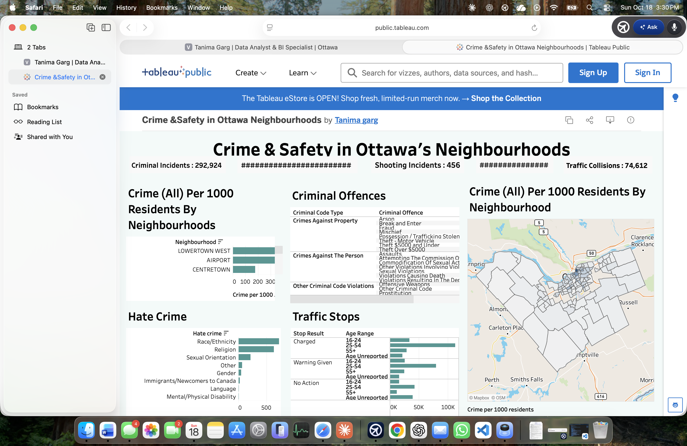

# eHospital — dbt Analytics Engineering Layer

A tested, documented [dbt](https://www.getdbt.com/) project that transforms raw
hospital data into governed KPI models, running locally on **DuckDB**.

This is the analytics-engineering layer of the eHospital project: the same KPIs
(appointment volume, cancellation rate, revenue, OHIP-vs-Private billing, top doctors,
top blood tests) rebuilt as modular, version-controlled, **tested** SQL models.

> Runs on **synthetic data** generated locally by `make_seeds.py` — no real patient
> data (PHI). DuckDB is a single-file local warehouse, so it runs with zero setup.

## The pipeline

```
raw seeds  ->  staging (clean)  ->  marts (KPIs)  ->  tests (proof)  ->  docs (lineage)
```

| Layer | Folder | What it does |
|------|--------|--------------|
| Raw | `seeds/` | Synthetic raw CSVs loaded as-is by `dbt seed` |
| Staging | `models/staging/` | Clean/typecast, derive `insurance_type` and week grains (views) |
| Marts | `models/marts/` | The six KPI tables analysts/BI read from |
| Tests | `models/staging/_staging.yml` | 15 data tests: `unique`, `not_null`, `accepted_values`, `relationships` |

## Run it

```bash
python3 -m venv venv && source venv/bin/activate
pip install -r requirements.txt

python make_seeds.py                 # generate synthetic raw CSVs
dbt seed  --profiles-dir .           # load raw CSVs into DuckDB
dbt run   --profiles-dir .           # build staging views + marts tables
dbt test  --profiles-dir .           # run all 15 data tests
dbt docs generate --profiles-dir .   # build the docs site
dbt docs serve    --profiles-dir .   # open docs + lineage graph in browser
```

## Why it matters

This is the workflow that reframes an analyst as **analytics-engineer-capable**:
modular SQL with `ref()`-driven dependency ordering (the DAG), tests that fail loudly
before bad data reaches a dashboard, and auto-generated documentation with full lineage.

**Tech:** dbt · DuckDB (portable to BigQuery/Snowflake by swapping `profiles.yml`) ·
staging/marts modeling · dbt tests · dbt docs.

## Migrated to Snowflake

The same dbt models now run on **Snowflake** as well as DuckDB. Only `profiles.yml` changes.

- **Least-privilege RBAC:** dedicated `DBT_ROLE` scoped to one schema, rolled up to `SYSADMIN`
- **Key-pair authentication:** a service user (`DBT_USER`) with no password; the private key never leaves the laptop
- **Cost control:** X-Small warehouse that auto-suspends after 60 seconds idle
- **Secrets stay out of Git:** connection settings come from environment variables (`.env.snowflake`, git-ignored)

```bash
# one-time: run snowflake/00_setup.sql in Snowsight, then register your public key on DBT_USER
set -a; source .env.snowflake; set +a
dbt debug --profiles-dir . --target snowflake    # connection check
dbt build --profiles-dir . --target snowflake    # 4 seeds, 10 models, 15 tests
```

### Migration validation
`snowflake/99_reconciliation.sql` compares every model's row count and total revenue against the DuckDB baseline.

| Check | DuckDB | Snowflake |
|---|---|---|
| `dbt build` (seeds, models, tests) | 29 / 29 pass | 29 / 29 pass |
| Row counts, 10 models | baseline | 10 / 10 match |
| Total revenue | $328,803.94 | $328,803.94 |


